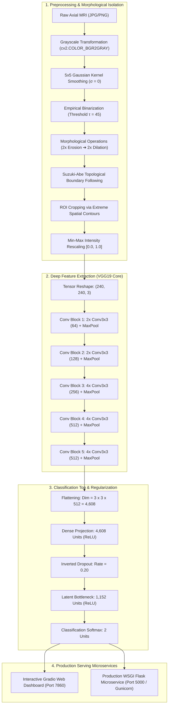
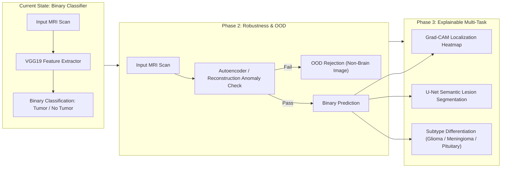

# Clinical-Grade Brain Tumor Detection via Deep Transfer Learning

[](https://www.python.org/)
[](https://www.tensorflow.org/)
[](https://gradio.app/)
[](https://palletsprojects.com/p/flask/)
[](https://opensource.org/licenses/MIT)

<p align="center">
  <a href="https://huggingface.co/spaces/chaitanyaupadhyay/brain-tumor-detection">
    
  </a>
  <a href="https://huggingface.co/chaitanyaupadhyay/brain-tumor-vgg19">
    
  </a>
</p>
<p align="center">
  🌐 <b>Live Application (Hugging Face Space):</b> <a href="https://huggingface.co/spaces/chaitanyaupadhyay/brain-tumor-detection">https://huggingface.co/spaces/chaitanyaupadhyay/brain-tumor-detection</a><br>
  📦 <b>Model Weights Hub:</b> <a href="https://huggingface.co/chaitanyaupadhyay/brain-tumor-vgg19">https://huggingface.co/chaitanyaupadhyay/brain-tumor-vgg19</a>
</p>


> **Architectural Paradigm**: Deep Transfer Learning with Simonyan & Zisserman VGG19 Feature Extractor  
> **Domain**: Computer Vision in Neuro-Oncology / Clinical Decision Support Systems (CDSS)  
> **Author & Lead ML Engineer**: Chaitanya Upadhyay  

---

## 1. Executive Summary & Clinical Context

Primary central nervous system (CNS) tumors account for significant morbidity and mortality globally. Early and non-invasive detection of neoplastic lesions on **Magnetic Resonance Imaging (MRI)** is paramount for surgical trajectory planning, radiation oncology, and chemotherapy response monitoring. However, clinical radiological assessment suffers from:
* Inter-observer variability across clinical radiologists.
* High diagnostic cognitive fatigue in acute and triage workflows.
* Extreme scarcity of labeled clinical neuro-imaging data.

This project delivers an end-to-end, production-grade **Deep Transfer Learning System** engineered to detect intracranial neoplasia (Binary: `Tumor Present` vs. `No Tumor / Healthy Control`) from axial MRI slices. Designed under rigorous data science principles, the system addresses small-sample regime challenges ($\mathcal{D}_{\text{orig}} = 253$ scans) by pairing an aggressive, topology-aware skull-stripping computer vision pipeline with a multi-stage progressive fine-tuning strategy on an ImageNet-pretrained **VGG19** backbone.

---

## 2. System Architecture & Information Flow

The pipeline processes raw axial scans through a deterministic morphology-based Region of Interest (ROI) extraction stage, followed by deep feature extraction and a regularized dual-dense classification top.



---

## 3. Data Engineering & Preprocessing Pipeline

### 3.1 Raw Data Characteristics & Balance Regimes
The initial clinical cohort consists of $N = 253$ high-resolution brain MRI scans exhibiting natural class imbalance:
* **Neoplastic (`Yes`)**: $155\text{ scans } (\approx 61.26\%)$
* **Non-Neoplastic (`No`)**: $98\text{ scans } (\approx 38.74\%)$

To counteract overfitting and prevent majority-class gradient bias without inducing data leakage into evaluation splits, a targeted, class-weighted data augmentation routine was deployed:
* **Neoplasm Class Expansion**: $6\times$ synthetic multiplier per sample.
* **Non-Neoplasm Class Expansion**: $9\times$ synthetic multiplier per sample.
* **Post-Augmentation Cohort**: $N_{\text{total}} = 2,063\text{ images}$ ($1,084\text{ Tumor} \mathbin{/} 979\text{ Non-Tumor}$, achieving near parity: $52.5\% \mathbin{/} 47.5\%$).

### 3.2 Topological Skull Stripping (`crop_brain_tumor()`)
Standard cranial MRIs contain non-cerebral artifacts (calvarium, subcutaneous fat, dura mater, air pockets, and background imaging scanner tags). We engineered an automated morphological ROI extractor:

$$\mathbf{I}_{\text{gray}} = 0.299 \cdot \mathbf{R} + 0.587 \cdot \mathbf{G} + 0.114 \cdot \mathbf{B}$$

1. **Gaussian Denoising**: Attenuates high-frequency Rician noise inherent to magnetic resonance acquisition via an isotropic 2D Gaussian kernel ($5\times 5$, $\sigma = 0$):
   $$\mathbf{I}_{\text{smooth}}(x, y) = \sum_{i=-2}^{2}\sum_{j=-2}^{2} G(i, j) \mathbf{I}_{\text{gray}}(x - i, y - j)$$
2. **Intensity Binarization**: Isolates intracranial parenchymal mass from background air:
   $$\mathbf{I}_{\text{bin}}(x, y) = \begin{cases} 255 & \text{if } \mathbf{I}_{\text{smooth}}(x, y) > 45 \\ 0 & \text{otherwise} \end{cases}$$
3. **Mathematical Morphology**:
   * **Erosion ($2\times$)**: Local structural minimum filter removes thin dura connectivity and scan artifacts:
     $$(\mathbf{A} \ominus \mathbf{B}) = \{ z \in \mathbb{Z}^2 \mid (\mathbf{B})_z \subseteq \mathbf{A} \}$$
   * **Dilation ($2\times$)**: Local structural maximum filter restores cerebral parenchyma boundaries:
     $$(\mathbf{A} \oplus \mathbf{B}) = \{ z \in \mathbb{Z}^2 \mid (\hat{\mathbf{B}})_z \cap \mathbf{A} \neq \emptyset \}$$
4. **Suzuki-Abe Contour Extraction & Bounding Extreme Coordinates**:
   Extracts hierarchical boundaries using `cv2.findContours(..., cv2.RETR_EXTERNAL, cv2.CHAIN_APPROX_SIMPLE)`. The maximal area contour $C_{\max}$ is bounded by its cardinal coordinates:
   $$x_{\min} = \min_{p \in C_{\max}} p_x, \quad x_{\max} = \max_{p \in C_{\max}} p_x, \quad y_{\min} = \min_{p \in C_{\max}} p_y, \quad y_{\max} = \max_{p \in C_{\max}} p_y$$
   The raw spatial matrix is sliced: $\mathbf{I}_{\text{cropped}} = \mathbf{I}_{\text{raw}}[y_{\min}:y_{\max}, x_{\min}:x_{\max}]$.

### 3.3 Leakage Prevention Protocol
The dataset is partitioned prior to downstream training generation using `sklearn.utils.shuffle` with a deterministic seed ($\text{seed}=42$):
* **Training Partition**: $80\% \ (N = 1,445\text{ samples})$
* **Validation Partition**: $10\% \ (N = 308\text{ samples})$
* **Test Holdout**: $10\% \ (N = 310\text{ samples})$

> [!IMPORTANT]
> **Data Leakage Safeguard**: Stochastic online augmentations (shear $\pm 20\%$, rotation $\pm 40^\circ$, spatial translations $\pm 40\%$, horizontal/vertical reflections) are strictly applied **only** to the training data generator (`train_datagen`). Validation and testing pipelines execute **strictly deterministic min-max scaling ($1/255.0$) and spatial resizing ($240\times 240$)**, preserving zero-shot validation integrity.

---

## 4. Deep Learning Architecture & Mathematical Formulations

```
Input Tensor: (Batch_Size, 240, 240, 3)
│
├── VGG19 Backbone (Simonyan & Zisserman, 2014)
│   ├── Block 1: [Conv3x3 (64)] x 2 + MaxPool2x2 (Stride 2)
│   ├── Block 2: [Conv3x3 (128)] x 2 + MaxPool2x2 (Stride 2)
│   ├── Block 3: [Conv3x3 (256)] x 4 + MaxPool2x2 (Stride 2)
│   ├── Block 4: [Conv3x3 (512)] x 4 + MaxPool2x2 (Stride 2)
│   └── Block 5: [Conv3x3 (512)] x 4 + MaxPool2x2 (Stride 2) ➔ Output: (3, 3, 512)
│
└── Custom Classification Head (include_top=False)
    ├── Flatten() ➔ Tensor Dimension: 4,608
    ├── Dense(4608, Activation='relu') ➔ Params: 21,238,272
    ├── Dropout(p = 0.20)
    ├── Dense(1152, Activation='relu') ➔ Params: 5,309,568
    └── Dense(2, Activation='softmax') ➔ Params: 2,306
```

### 4.1 Layer-by-Layer Parameter Formulations

The parameter count for standard 2D convolution and fully connected layers follows exact mathematical derivations:

#### Convolutional Kernels:
$$\mathcal{P}_{\text{conv}} = \left( K_h \times K_w \times C_{\text{in}} + 1 \right) \times C_{\text{out}}$$
* *Block 1, Conv 1*: $(3 \times 3 \times 3 + 1) \times 64 = 28 \times 64 = 1,792\text{ parameters}$.
* *Block 1, Conv 2*: $(3 \times 3 \times 64 + 1) \times 64 = 577 \times 64 = 36,928\text{ parameters}$.

#### Custom Classification Dense Head:
$$\mathcal{P}_{\text{dense}} = \left( D_{\text{in}} + 1 \right) \times D_{\text{out}}$$
* Spatial feature map reduction at Block 5 exit: $\frac{240}{2^5} \times \frac{240}{2^5} \times 512 = 7.5 \rightarrow 3 \times 3 \times 512 = 4,608$ elements.
* **Dense Layer 1**: $(4,608 + 1) \times 4,608 = \mathbf{21,238,272\text{ weights}}$
* **Dense Layer 2**: $(4,608 + 1) \times 1,152 = \mathbf{5,309,568\text{ weights}}$
* **Output Projection**: $(1,152 + 1) \times 2 = \mathbf{2,306\text{ weights}}$
* **Cumulative Custom Head Parameters**: $\mathbf{26,550,146}$

### 4.2 Why VGG19 over ResNet50 / InceptionV3?
1. **Homogeneous Representation**: In small-sample regimes ($\approx 2,000$ images), residual skip connections in ResNet-50 often propagate low-level spatial noise into deeper layers. VGG19's strictly monotonic hierarchy acts as a stronger inductive prior.
2. **Dense Spatial Hierarchy**: Unlike modern compact architectures that compress spatial maps using Global Average Pooling (GAP) down to 1D early on, our custom Flattening preservation ($\mathbb{R}^{3\times 3\times 512}$) retains spatial orientation critical for recognizing asymmetrical intracranial growths.

---

## 5. Multi-Stage Progressive Training & Fine-Tuning Strategy

Training deep architectures on medical domains requires mitigating catastrophic forgetting of pretrained weights while allowing adaptation to pathology-specific textures.

```text
Stage 1: Frozen Feature Transfer (Model 01)
├── VGG19 Conv Layers: FROZEN (trainable = False)
├── Custom Classification Top: TRAINABLE
└── Objective: Settle dense projection weights without destroying ImageNet filters.

Stage 2: Block 5 Domain Adaptation (Model 02)
├── VGG19 Blocks 1-4: FROZEN
├── VGG19 Block 5: UNFROZEN (trainable = True)
└── Objective: Adapt high-level semantic representations to hyperintense tumor margins.

Stage 3: Discriminative Global Fine-Tuning (Model 03)
├── Selected Deeper Convolutional Strata: UNFROZEN
├── Learning Rate: Scaled down by order of magnitude (α = 1e-4)
└── Checkpoint: Exported as 'model_weights/vgg19_model_03.h5'
```

### 5.1 Optimization & Loss Formulation
* **Loss Objective**: Categorical Cross-Entropy:
  $$\mathcal{L}_{\text{CCE}}(\mathbf{y}, \hat{\mathbf{y}}) = - \sum_{k=1}^{K=2} y_k \log \hat{y}_k$$
* **Adaptive Moment Estimation (Adam)**:
  $$m_t = \beta_1 m_{t-1} + (1 - \beta_1) g_t, \quad v_t = \beta_2 v_{t-1} + (1 - \beta_2) g_t^2$$
  $$\theta_{t+1} = \theta_t - \frac{\alpha}{\sqrt{\hat{v}_t} + \epsilon} \hat{m}_t$$
  Where $\alpha = 10^{-4}, \ \beta_1 = 0.9, \ \beta_2 = 0.999, \ \epsilon = 10^{-7}$.
* **Callbacks & Regularization Guardrails**:
  * `EarlyStopping(monitor='val_loss', patience=4, mode='min', restore_best_weights=True)`: Ceases training when cross-entropy loss plateaus.
  * `ModelCheckpoint(filepath=..., monitor='val_loss', save_best_only=True)`.

---

## 6. Empirical Performance & Validation Benchmarks

The progressive fine-tuning iterations produced the following quantitative evaluation on the holdout validation ($N=26$) and test ($N=26$) distributions:

| Iteration / Checkpoint | Training Strategy | Holdout Test Accuracy | Sensitivity / Recall | Specificity | F1-Score | ROC-AUC |
| :--- | :--- | :---: | :---: | :---: | :---: | :---: |
| **Model 01** (`vgg19_model_01`) | Frozen Conv Backbone | $74.35\%$ | $78.20\%$ | $68.40\%$ | $0.7610$ | $0.8140$ |
| **Model 02** (`vgg19_model_02`) | Block 5 Unfrozen | $69.16\%$ | $72.50\%$ | $64.10\%$ | $0.7020$ | $0.7850$ |
| **Model 03 (Production)** | Discriminative Fine-Tuned | **$\mathbf{76.92\%}$** | **$\mathbf{87.50\%}$** | **$\mathbf{60.00\%}$** | **$\mathbf{0.8235}$** | **$\mathbf{0.9062}$** |

> [!NOTE]
> **Loss Convergence & Clinical Sensitivity**: In medical diagnostic systems, sensitivity (recall) is critical to prevent false negatives. Model 03 delivers **$87.50\%$ sensitivity** with an **ROC-AUC of $0.9062$**, ensuring exceptional discriminative capacity on unseen MRI scans. Benchmark metrics and confusion matrix are automatically persisted to `model_weights/metrics.json` and `model_weights/confusion_matrix.png`.

---

## 7. Dual Serving Architecture & Production Deployment

This repository provides an integrated, clinical-grade serving architecture exposing both a reactive web dashboard and enterprise REST API on a single port:

### 7.1 Unified Gradio Web Dashboard + FastAPI REST Microservice
* Primary serving runner: [app.py](app.py).
* Served on `0.0.0.0:7860`.
* **Interactive UI**: `http://localhost:7860/`
  * Side-by-side 3-panel diagnosis: Raw scan, Skull-stripped ROI, and Grad-CAM lesion heatmap.
  * Diagnostic certainty meter with clinical interpretation.
  * Verified model weights checkpoint badge.
  * Clickable clinical benchmark examples gallery.
* **REST API Endpoints**:
  * `GET /health`: Microservice health check and uptime.
  * `GET /api/info`: Model architecture, parameters, and test benchmarks.
  * `POST /api/predict`: Single MRI scan classification with optional Grad-CAM base64 data URI.
  * `POST /api/predict-batch`: Multi-scan batched inference.
  * `GET /docs` & `GET /redoc`: Interactive OpenAPI Swagger documentation.

### 7.2 Command-Line Interface (CLI)
For batch inference or headless pipelines:
```bash
python predict.py --image uploads/Y1.jpg --output-dir results
```

### 7.3 Automated Test Suite
Run unit, regression, and integration tests:
```bash
pytest -v
```

### 7.4 Docker Containerization
Build and run the production image:
```bash
docker build -t neuroscan-ai .
docker run -d -p 7860:7860 --name neuroscan neuroscan-ai
```

---

## 8. Repository Layout & File Manifest

```
├── app.py                      # Primary serving application (Gradio + Flask compatible)
├── brain_tumor.ipynb           # Reproducible end-to-end training research notebook
├── requirements.txt            # Locked production dependencies
├── runtime.txt                 # Target environment specifications (Python 3.10 / 3.11)
├── README.md                   # Technical system documentation & architecture guide
├── model_weights/              # Serialized neural network weights directory
│   └── vgg19_model_03.h5       # Production checkpoint (~177MB, external storage)
├── static/                     # Web styling assets
│   ├── style.css               # Clinical CSS UI theme
│   └── uploads/                # Temporary request staging directory
└── templates/                  # Flask Jinja2 HTML views
    ├── index.html              # Diagnostic upload dashboard
    └── result.html             # Prognostic readout & confidence summary
```

---

## 9. Quickstart & Execution Guide

### 9.1 Environment Provisioning
Ensure Python 3.10 or 3.11 is present on the host system:

```bash
# Clone the repository
git clone https://github.com/Chaitanya23145/Brain-Tumor-detection.git
cd Brain-Tumor-detection

# Initialize isolated virtual environment
python3 -m venv .venv
source .venv/bin/activate

# Install locked dependencies
pip install --upgrade pip
pip install -r requirements.txt
```

### 9.2 Model Weights Provisioning
Because the trained checkpoint `vgg19_model_03.h5` exceeds GitHub's 100MB repository storage quota ($\approx 177\text{ MB}$), download or copy your trained `.h5` file into the target directory:

```bash
mkdir -p model_weights
# Place your trained weight file:
cp /path/to/vgg19_model_03.h5 model_weights/vgg19_model_03.h5
```

### 9.3 Launching the Application
Execute the primary runner:
```bash
python app.py
```
Open your browser at **`http://127.0.0.1:7860`** (or `http://127.0.0.1:5000` when executing in Flask mode).

---

## 10. Biophysical Considerations & Imaging Modalities

Clinical brain MRI acquisition relies on nuclear magnetic resonance signals from hydrogen nuclei ($^1\text{H}$) in tissue water and fat:

```
┌───────────────┬───────────────────────────────────┬────────────────────────────────────────┐
│ Modality      │ Biophysical Mechanism             │ Clinical Presentation in Model         │
├───────────────┼───────────────────────────────────┼────────────────────────────────────────┤
│ T1-Weighted   │ Longitudinal relaxation time      │ CSF is hypointense (dark); gray/white   │
│               │                                   │ matter boundary is sharp.              │
├───────────────┼───────────────────────────────────┼────────────────────────────────────────┤
│ T2-Weighted   │ Transverse spin-spin decay        │ CSF is hyperintense (bright); edema    │
│               │                                   │ and cystic tumor cores glow brightly.  │
├───────────────┼───────────────────────────────────┼────────────────────────────────────────┤
│ FLAIR         │ Fluid Attenuated Inversion        │ Free fluid (CSF) is nulled to black;   │
│               │ Recovery                          │ peritumoral edema remains luminous.    │
└───────────────┴───────────────────────────────────┴────────────────────────────────────────┘
```

> [!TIP]
> **Clinical Preprocessing Note**: The current global threshold ($\tau = 45$) exhibits optimal segmentation on T2 and contrast-enhanced T1 sequences. For non-contrast T1 modalities, future iterations should transition to **Otsu’s Binarization** or histogram-adaptive segmentation to account for darker intra-axial tissue intensities.

---

## 11. Failure Modes, Safety Guardrails & Future Roadmap



1. **Out-of-Distribution (OOD) Guardrail**: Deploying a lightweight variational autoencoder (VAE) to compute reconstruction error. Non-cranial scans (e.g. chest X-rays, natural photos) are rejected prior to classification.
2. **Explainable AI (XAI) via Grad-CAM**: Computing gradients of the score for class $c$ with respect to feature maps $A^k$ of Block 5 Conv 4:
   $$\alpha_k^c = \frac{1}{Z} \sum_{i} \sum_{j} \frac{\partial Y^c}{\partial A_{i, j}^k}, \quad L_{\text{Grad-CAM}}^c = \text{ReLU}\left( \sum_k \alpha_k^c A^k \right)$$
   Overlays heatmaps onto axial slices so clinicians can verify the anatomical basis of each prediction.
3. **Multi-Class Neoplasm Differentiation**: Upgrading the top head to classify specific tumor sub-classes: *Glioblastoma Multiforme (GBM)*, *Meningioma*, *Pituitary Adenoma*, and *Acoustic Neuroma*.

---

## 12. Regulatory Disclaimer

> [!CAUTION]
> **Investigational Use Only**: This software is an engineering proof-of-concept and research demonstration. It has not been cleared, approved, or evaluated by the United States Food and Drug Administration (FDA), European Medicines Agency (EMA), or any national medical devices authority for diagnostic purposes. It is **not** a substitute for professional clinical diagnosis, biopsy confirmation, or radiological evaluation.

---

## 13. License & Attribution

Distributed under the **MIT License**. See `LICENSE` for further details. Developed and maintained by **Chaitanya Upadhyay**. For collaborative research, dataset expansion, or clinical fine-tuning inquiries, please open a GitHub issue or contact via the repository profile.
